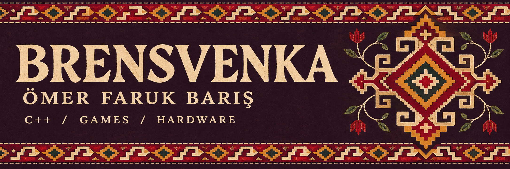
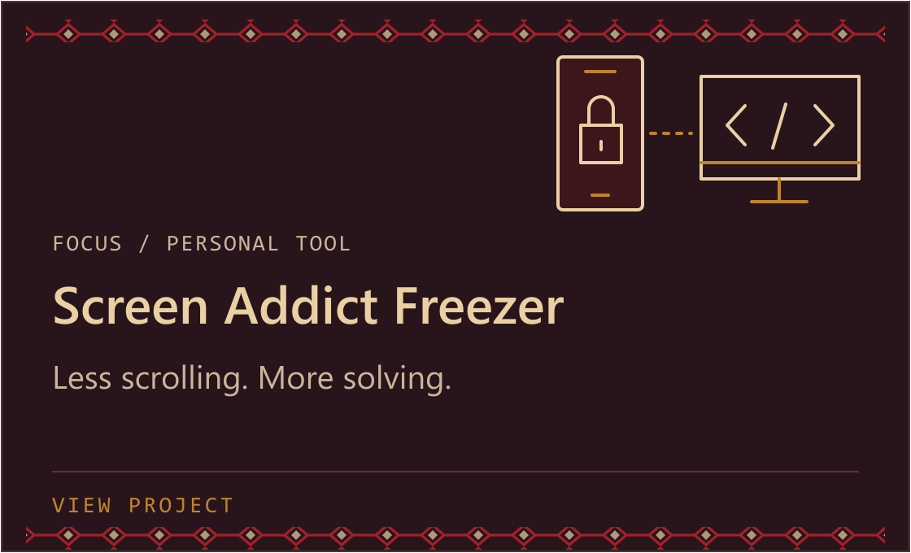
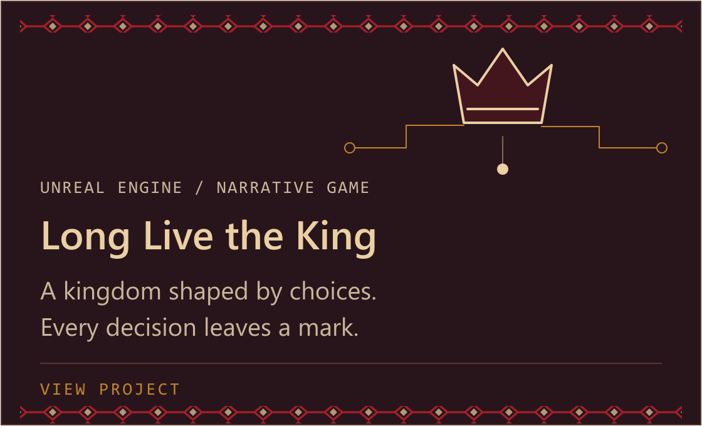
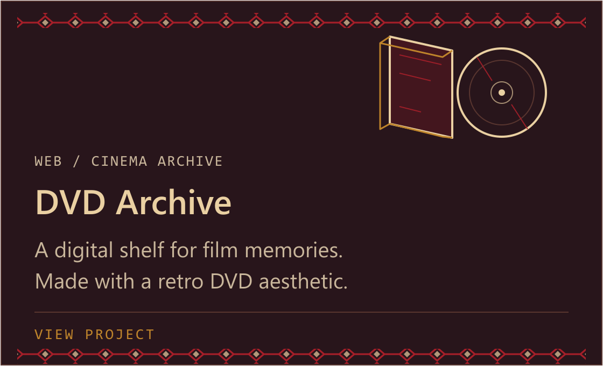
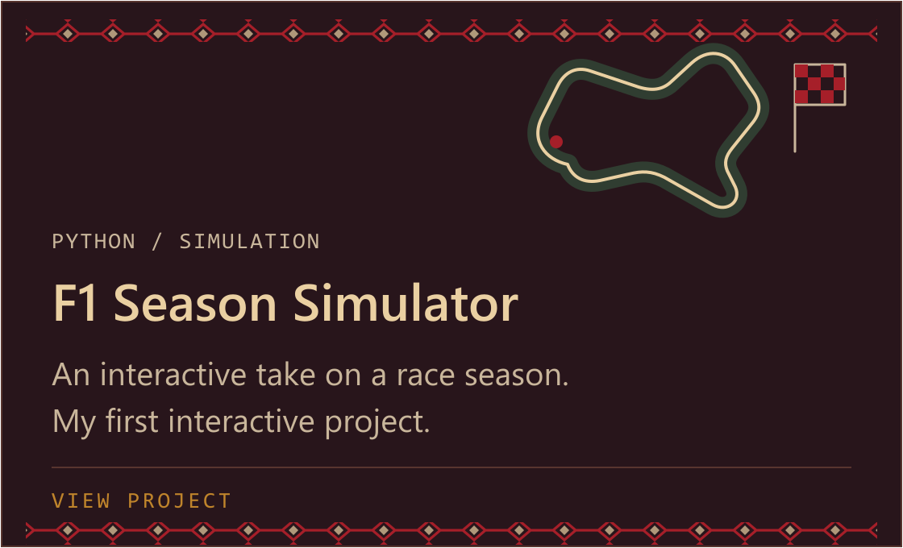

  <a href="#a-few-things-ive-built">Projects</a> &nbsp; · &nbsp;
  <a href="#what-im-exploring">What I'm exploring</a> &nbsp; · &nbsp;
  <a href="https://www.linkedin.com/in/%C3%B6mer-faruk-bar%C4%B1%C5%9F-1488a7323/">LinkedIn</a>

## Hey, I'm Ömer.

I'm a **computer engineering student** in Istanbul, drawn to the hardware side of software. I build games and personal tools, experiment with code, and occasionally turn a personal obsession into a project.

That includes a kingdom full of difficult choices, a digital shelf for my films, a Formula 1 season I can simulate, and a focus tool I use myself.

### A few things I've built

  
  

  
  

**[Screen Addict Freezer](https://github.com/Brensvenka/Screen_Addict_Freezer)** is a personal focus tool I actively use. It restricts social media on my phone, and I unlock access by solving a C++ OOP question on my computer.

**[Long Live the King](https://brensvenka.itch.io/long-live-the-king)** is my narrative game project: choices, dice rolls, and branching paths through a kingdom. Made with Unreal Engine, with scene and character design contributions from Zehranur Çevik.

**[DVD Archive](https://brensvenka.github.io/DVD_Archive/)** brings my Letterboxd archive to a retro DVD shelf. **[F1 Season Simulator](https://github.com/Brensvenka/Formula-1-Season-2025-Simulator)** was my first interactive project.

### What I'm exploring

- **C++ & computer science** — object-oriented programming, algorithms, and understanding why things work.
- **Hardware & embedded systems** — circuits now; learning to bring software closer to the physical world.
- **Interactive storytelling** — branching narratives and the consequences of a player's choices.

---

  Somewhere between a circuit diagram, a branching story, and the end credits. 
  <a href="https://www.linkedin.com/in/%C3%B6mer-faruk-bar%C4%B1%C5%9F-1488a7323/">LinkedIn</a> &nbsp; · &nbsp;
  <a href="https://brensvenka.itch.io/">itch.io</a> &nbsp; · &nbsp;
  <a href="https://github.com/Brensvenka?tab=repositories">Repositories</a>

